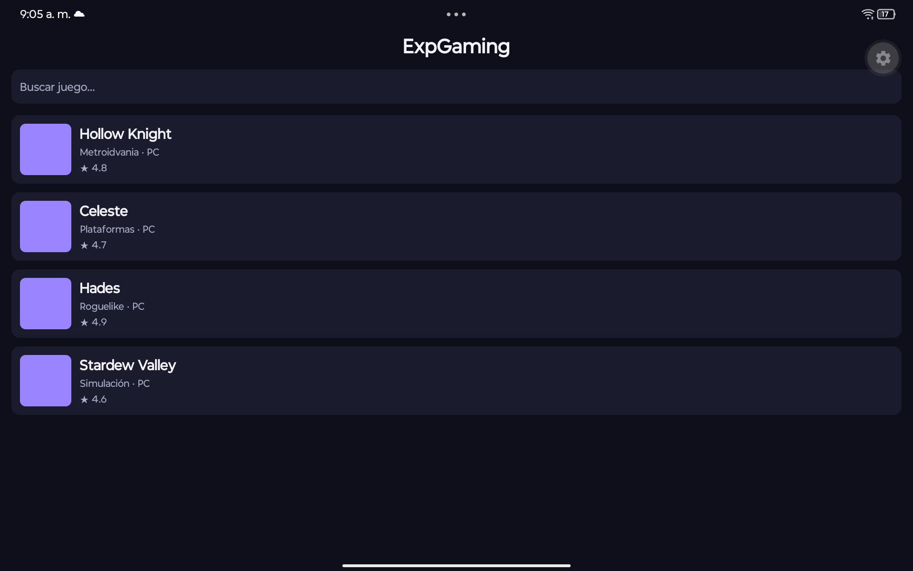
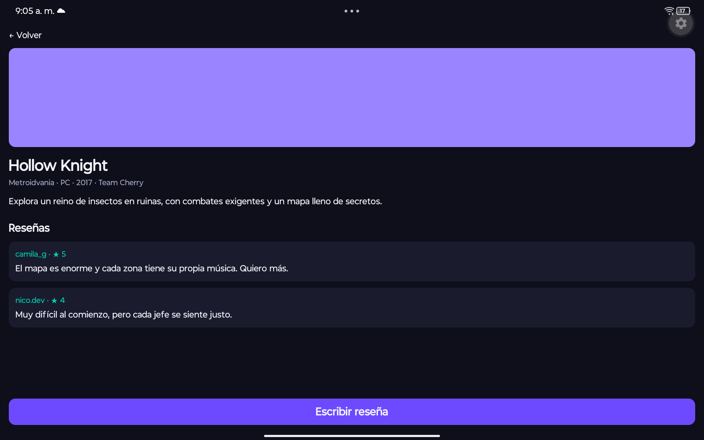
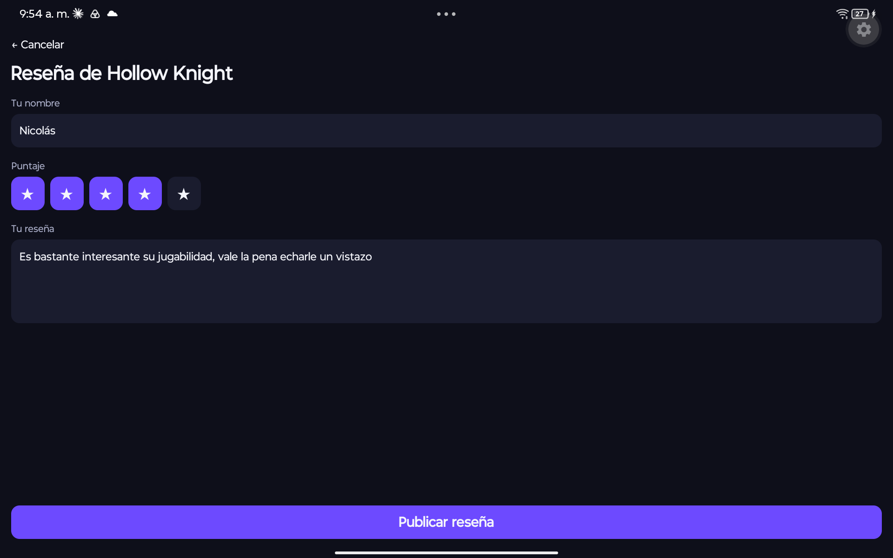

# ExpGaming

App móvil de reseñas de videojuegos. Permite explorar un catálogo de juegos, ver el detalle de cada uno y publicar tu propia reseña con un puntaje de 1 a 5 estrellas.

Proyecto del **Avance N°1: Diseño UI/UX y Frontend Móvil** del curso Tecnologías Web y Móviles (Universidad de Los Lagos).

- **Diseño en Figma:** https://www.figma.com/design/yktOt6tXWoLBhvcXe5eNsK/ExpGaming?node-id=0-1
- **Bitácora del proyecto:** [docs/bitacora.md](docs/bitacora.md)

## Pantallas

| Inicio | Detalle del juego | Escribir reseña |
|:---:|:---:|:---:|
|  |  |  |

1. **Inicio:** lista de juegos con buscador por título.
2. **Detalle:** portada, datos del juego, descripción y reseñas de otros usuarios.
3. **Escribir reseña:** formulario con nombre, puntaje y texto. Valida los campos antes de publicar, y la reseña nueva aparece de inmediato en el detalle.

## Tecnologías

- React Native con Expo (SDK 58)
- Expo Router (navegación basada en archivos)
- TypeScript
- React Context para el estado compartido de juegos y reseñas

## Requisitos

- Node.js (LTS reciente; probado con v26.13.1) y npm
- App **Expo Go** en el teléfono, compatible con SDK 58
- Teléfono y computador conectados a la misma red Wi-Fi

## Cómo ejecutar

```bash
git clone https://github.com/BenjaminAlocilla2005/ExpGaming.git
cd ExpGaming
npm install
npx expo start
```

Luego escanea el código QR que aparece en la terminal con Expo Go.

## Estructura del proyecto

```
src/
├── app/
│   ├── _layout.tsx        # Navegación (Stack) y proveedor de estado
│   ├── index.tsx          # Pantalla Inicio
│   ├── juego/[id].tsx     # Pantalla Detalle
│   └── resena/[id].tsx    # Pantalla Escribir reseña
├── components/            # Componentes reutilizables
│   ├── BotonPrimario.tsx
│   ├── CampoTexto.tsx
│   ├── EncabezadoPantalla.tsx
│   ├── SelectorPuntaje.tsx
│   └── TarjetaJuego.tsx
├── constants/             # Colores, tipografía y medidas (iguales a Figma)
├── context/
│   └── JuegosContext.tsx  # Estado de juegos y función agregarResena
└── data/
    └── juegos.ts          # Datos de ejemplo
```

## Autor

Benjamín Alocilla