# Bitácora del proyecto ExpGaming

**Avance N°1: Diseño UI/UX y Frontend Móvil** · Tecnologías Web y Móviles · Universidad de Los Lagos
**Autor:** Benjamín Alocilla · **Fecha:** 22 de noviembre de 2026

- Diseño en Figma: https://www.figma.com/design/yktOt6tXWoLBhvcXe5eNsK/ExpGaming?node-id=0-1
- Repositorio: https://github.com/BenjaminAlocilla2005/ExpGaming

ExpGaming es una app móvil de reseñas de videojuegos: el usuario explora un catálogo, lee el detalle de cada juego y publica su propia reseña con puntaje.

---

## 1. Identidad de marca y UI Kit

**Nombre:** ExpGaming. **Logo:** un control de videojuego blanco sobre fondo violeta, pensado para ser reconocible en tamaño pequeño.

**Pantalla de carga (splash):** fondo violeta con el logo al centro, configurada en `app.json`.

### Paleta de colores

| Rol | Nombre en Figma | HEX |
|---|---|---|
| Primario | Primary/500 | `#6D4AFF` |
| Primario claro | Primary/300 | `#9B84FF` |
| Secundario | Secondary/500 | `#00D1B2` |
| Fondo | Neutral/900 | `#0E0F1A` |
| Superficie (tarjetas, campos) | Neutral/800 | `#1A1C2E` |
| Texto secundario | Neutral/300 | `#A9ADC7` |
| Texto principal | Neutral/100 | `#F4F5FB` |
| Error | Semantic/Error | `#FF6B7A` |
| Éxito | Semantic/Success | `#34D399` |
| Advertencia | Semantic/Warning | `#FFB020` |

### Tipografía (fuente Inter)

| Estilo | Tamaño / interlineado | Peso | Uso |
|---|---|---|---|
| Title/H1 | 28 / 34 | Bold | Títulos de pantalla |
| Subtitle/H2 | 20 / 26 | SemiBold | Nombres de juego, botones, secciones |
| Body/M | 16 / 24 | Regular | Texto general |
| Label/S | 14 / 20 | Medium | Datos secundarios, etiquetas |

### UI Kit

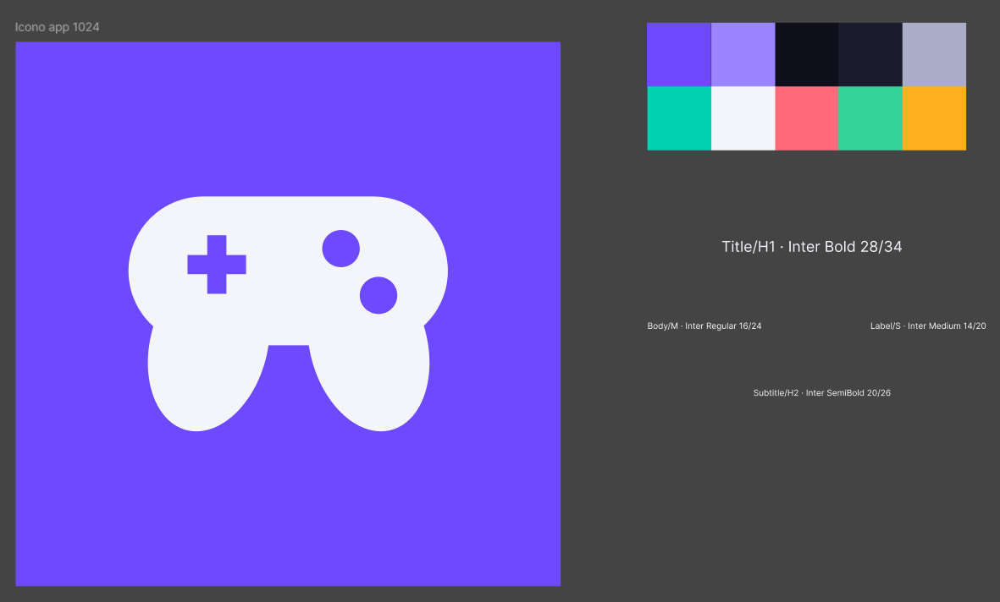

Componentes reutilizados en la app: tarjeta de juego, botón primario, campo de texto, selector de puntaje (5 estrellas) y encabezado con botón de volver.

### Contraste (texto sobre fondo)

| Combinación | Contraste aproximado |
|---|---|
| Texto principal sobre fondo | 17:1 |
| Texto secundario sobre fondo | 8:1 |
| Texto principal sobre superficie | 15:1 |
| Texto del botón sobre violeta primario | 4,7:1 |
| Violeta primario sobre fondo (botones) | 3,7:1 |

Todas las combinaciones superan el mínimo de 3:1 exigido.

---

## 2. Arquitectura y flujo de usuario

### Storyboard

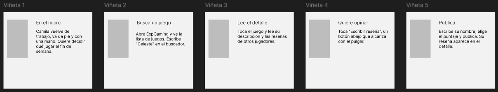

1. **En el micro:** el usuario quiere decidir qué jugar y abre la app.
2. **Busca un juego:** escribe el título en el buscador.
3. **Lee el detalle:** revisa la información y las reseñas de otros.
4. **Quiere opinar:** toca "Escribir reseña".
5. **Publica:** completa el formulario y su reseña aparece en el detalle.

### Mapa de navegación

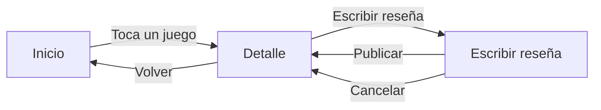

---

## 3. Evolución visual: wireframes y mockups

| Wireframes (escala de grises) | Mockups (alta fidelidad) |
|:---:|:---:|
| 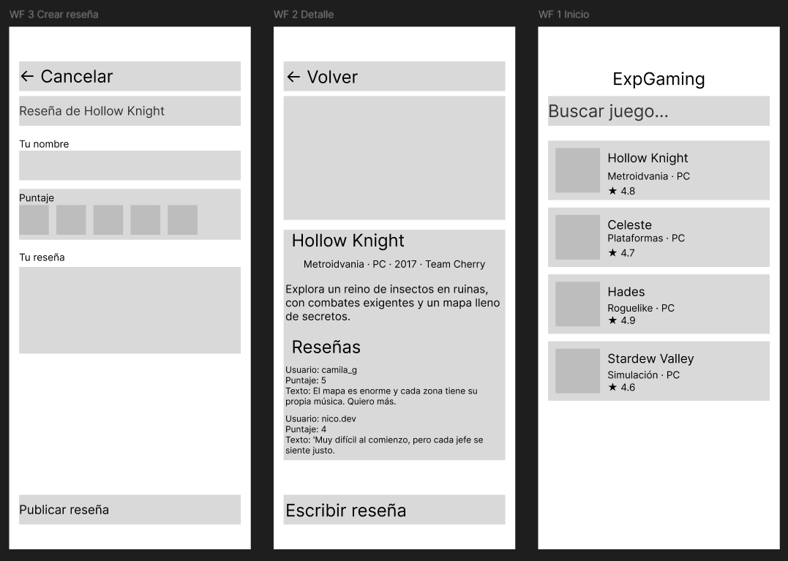 | 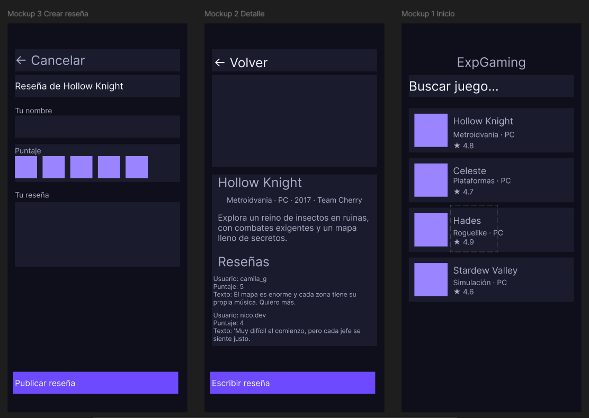 |

Los wireframes definieron la estructura (buscador, lista, botón al pie). Los mockups agregaron la paleta, la tipografía, las portadas y los estados de color. El prototipo navegable de Figma enlaza las 3 pantallas.

---

## 4. Evidencia del frontend (app en Expo Go)

| Inicio | Búsqueda |
|:---:|:---:|
| 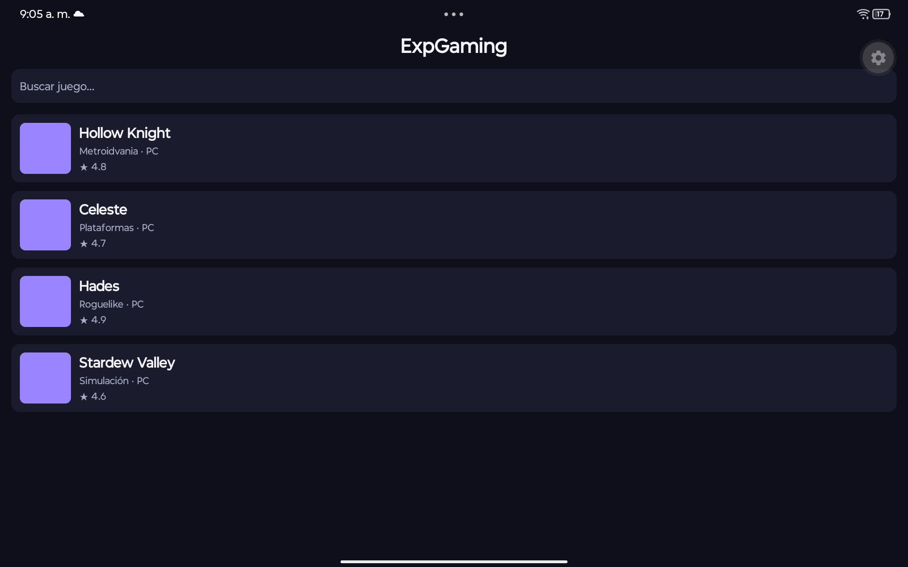 | 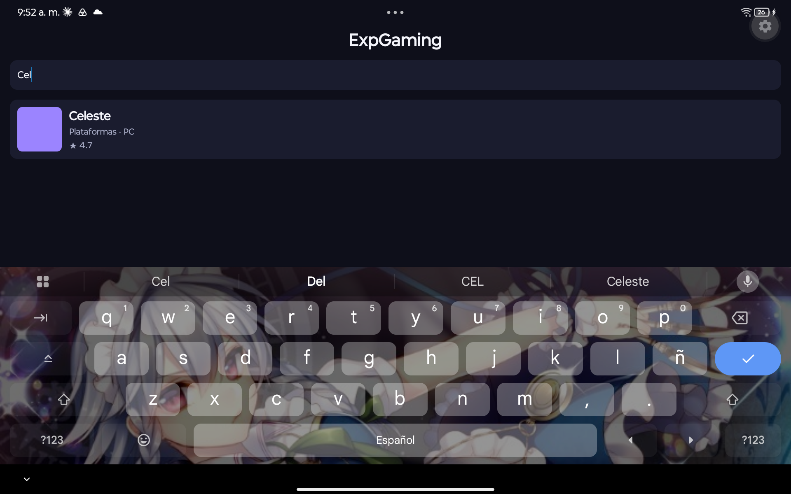 |

| Detalle | Escribir reseña |
|:---:|:---:|
| 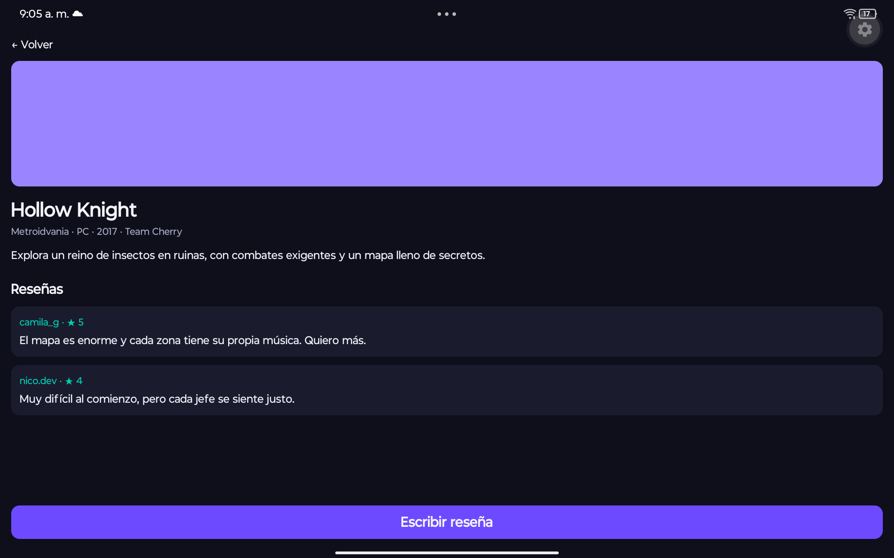 | 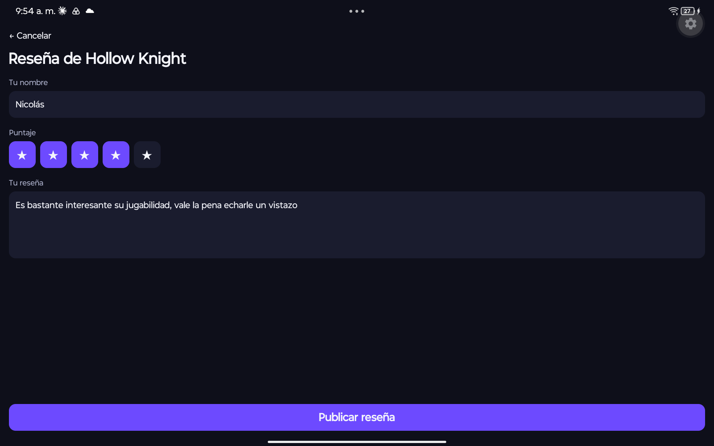 |

| Validación de campos vacíos | Reseña publicada en el detalle |
|:---:|:---:|
| 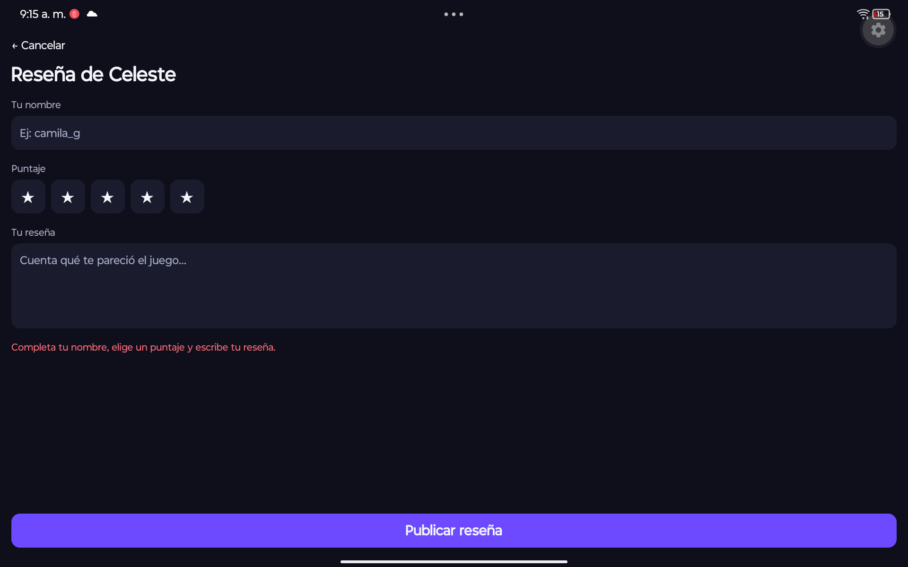 | 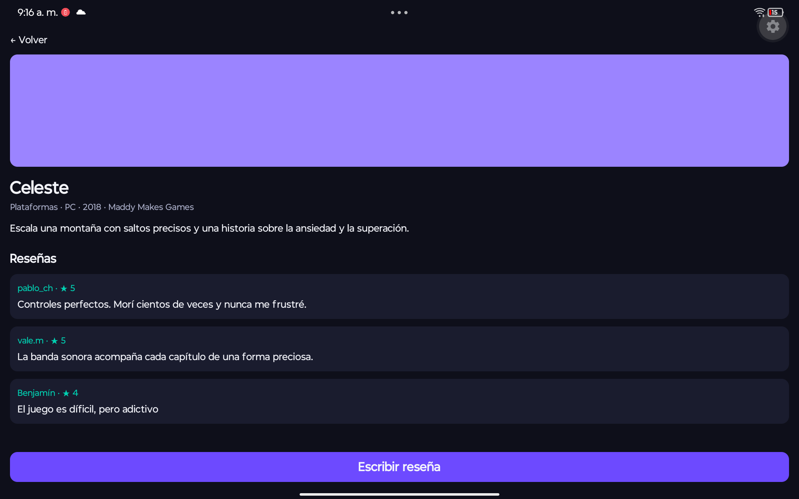 |

---

## 5. Justificación técnica y ergonómica

**Decisiones de diseño**
- **Tema oscuro:** los jugadores usan el móvil en ambientes con poca luz, y el contraste alto de texto claro sobre fondo oscuro reduce el cansancio visual.
- **Botón de acción al pie:** "Escribir reseña" y "Publicar reseña" quedan en la zona del pulgar, fáciles de alcanzar con una mano.
- **Áreas táctiles de 48 dp o más:** tarjetas, botones, estrellas y barra de volver cumplen el mínimo (constante `tactilMinimo`).
- **Jerarquía clara:** título, datos secundarios y descripción usan 4 estilos tipográficos consistentes.
- **Retroalimentación:** los elementos tocables cambian de opacidad al presionarse y el formulario muestra un mensaje de error cuando faltan datos.

**Decisiones técnicas**
- **Expo Router (rutas por archivos):** `index.tsx` (Inicio), `juego/[id].tsx` (Detalle) y `resena/[id].tsx` (Reseña). Las rutas dinámicas `[id]` permiten reutilizar una misma pantalla para cualquier juego.
- **Estado compartido con React Context:** `JuegosContext` guarda la lista de juegos y la función `agregarResena`, por lo que una reseña nueva aparece de inmediato en el detalle.
- **Componentes reutilizables:** `TarjetaJuego`, `BotonPrimario`, `CampoTexto`, `SelectorPuntaje` y `EncabezadoPantalla`.
- **Constantes iguales a Figma:** `colores.ts`, `tipografia.ts` y `medidas.ts` usan los mismos valores que los estilos de Figma.
- **FlatList** para las listas, **TextInput controlado** para el buscador y los campos, **Pressable** para los elementos tocables.
- **Datos de ejemplo realistas** en `data/juegos.ts` (4 juegos con 2 reseñas cada uno).

---

## 6. Bitácora de IA generativa

**Herramienta usada:** Claude (Anthropic), mediante claude.ai.

**Para qué la usé:** guía paso a paso para armar el diseño en Figma, estructura del proyecto Expo, código de pantallas y componentes, README y esta bitácora. Las decisiones de producto (idea de la app, nombre, paleta, flujo y contenido de los datos) son mías. Probé todo el código en Expo Go antes de subirlo.

### Prompts principales

| N.º | Prompt (resumen) | Resultado |
|---|---|---|
| 1 | Adjunté la rúbrica del Avance N°1 y pregunté qué debía tener el Figma para cumplirla | Lista de elementos mínimos por criterio y páginas sugeridas |
| 2 | Subí una captura de mi Figma y pregunté qué necesitaba hacer y cuántas páginas pedía la rúbrica | Propuesta de páginas y contenido de cada una |
| 3 | Subí solo una captura de VS Code, sin texto, con el terminal ya abierto en la carpeta del proyecto (ExpGaming) | Código de contexto, componentes y pantalla de Inicio que probé en Expo Go |

**Prompt 1:** "Necesito ayuda para saber qué debo hacer en la entrega, ando haciendo el diseño en Figma y necesito ver qué me pide para que pueda hacerlo bien, ¿Qué debo tener en el Figma?"

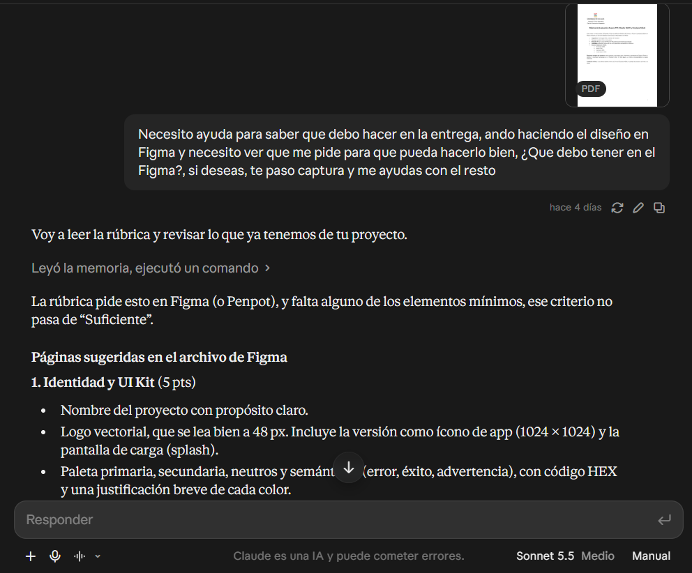

**Prompt 2:** "Esto tengo hasta ahora, ¿Qué necesito hacer aquí?, ¿Cuántas páginas necesito para que se cumpla lo de la rúbrica?"

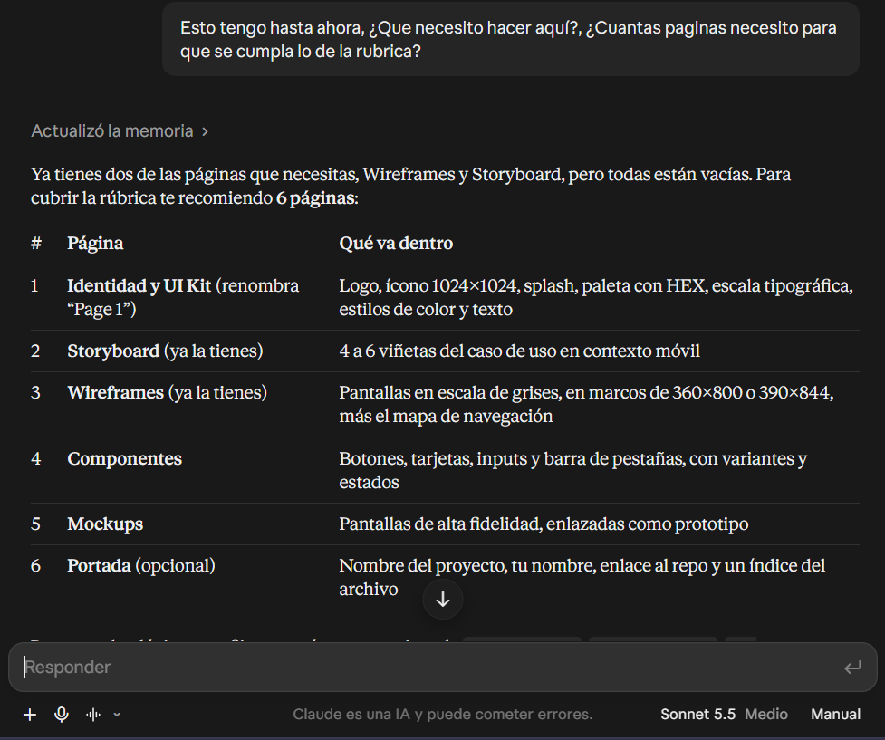

**Prompt 3:** captura de VS Code enviada sin texto adicional

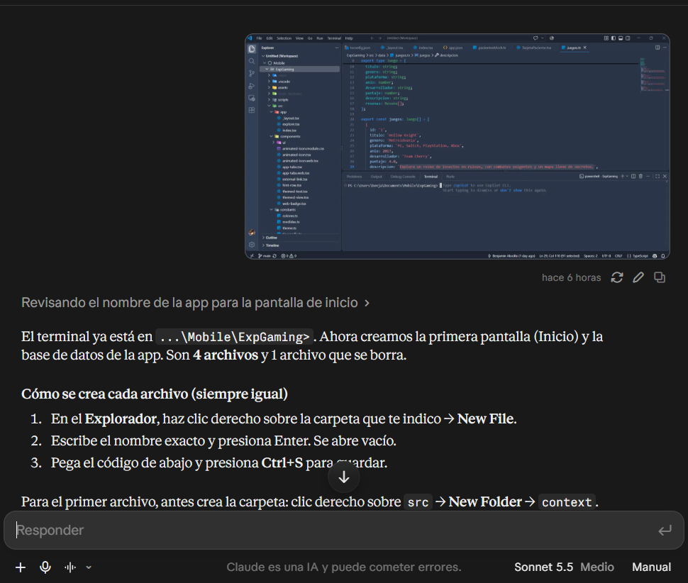

### Errores y alucinaciones detectados y corregidos

| Qué falló | Cómo lo detecté | Corrección |
|---|---|---|
| La IA recomendó 6 páginas en Figma, pero el plan gratuito permite solo 3 | Figma no me dejó crear más páginas | Agrupé el contenido en 3: Identidad y UI Kit, Storyboard y Wireframes, Mockups y prototipo |
| Un wireframe tenía una imagen real pegada, contra la regla de escala de grises | Revisé el wireframe contra la rúbrica | Lo reemplacé por un cuadro gris |
| La medida del campo de nombre del wireframe 3 (alto 240) tapaba el título y las etiquetas | Se veía solapado en Figma | Lo corregí a alto 48 y reubiqué las etiquetas |
| La descripción del mockup 2 era la de Celeste, no la de Hollow Knight | La comparé con `juegos.ts` | Copié el texto correcto |
| Los datos de Figma no coincidían con la app (Hades decía "Rougelike" y Celeste ★ 5) | Comparé el mockup con la captura de la app | Corregí los textos a "Roguelike" y "★ 4.7" |
| El comando para copiar el ícono supuso que el archivo estaba en Descargas | El terminal dio error de ruta | Comprobé que el archivo ya estaba en el proyecto |
| El terminal de VS Code estaba abierto en otra carpeta del workspace (vetchiloe-terreno) y no en ExpGaming | Lo vi en la captura que subí a Claude | Cerré ese terminal y abrí uno nuevo dentro de ExpGaming |